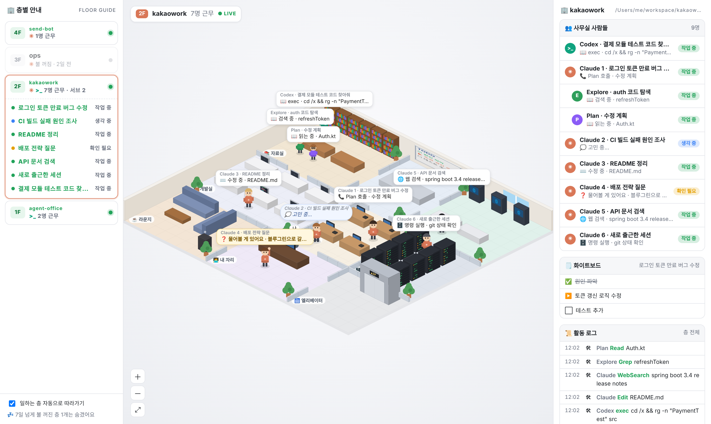

# 🏢 Agent Office

> Claude Code / Codex 세션을 아이소메트릭 사무실 빌딩으로 실시간 시각화하는 로컬 대시보드
> *A local dashboard that turns your Claude Code & Codex sessions into a live isometric office.*


<sub>스크린샷은 가짜 세션 데이터로 찍은 화면이에요.</sub>

터미널에서 에이전트가 뭘 하고 있는지 한눈에 보고 싶어서 만든 사무실이에요.
에이전트가 파일을 읽으면 자료실에 가서 책을 펴고, 명령을 돌리면 서버실 랙 앞에 서 있어요.
고민할 땐 생각 구름을 띄우고, 일을 나눠 맡기면 서브에이전트가 엘리베이터를 타고 출근해요.

> 📖 **[활용 가이드](docs/USAGE.md)**: 이럴 때 쓰면 좋은 상황, 화면 읽는 법, 항상 켜 두기, 커스터마이즈, 문제 해결

## 실행

```bash
node agent-office.mjs
# → http://localhost:4777
```

또는 설치 없이 바로 실행할 수 있어요.

```bash
npx github:<your-github-id>/agent-office
```

- Node.js 18 이상만 있으면 돼요. 설치할 패키지가 없어요.
- 훅이나 설정은 건드리지 않아요. 세션 기록(jsonl)을 **읽기만** 해요.
- `127.0.0.1`에서만 열려서 다른 사람은 접속할 수 없어요.

### 옵션

| 옵션 | 설명 | 기본값 |
|---|---|---|
| `--port 5000` | 포트 | `4777` |
| `--live 30` | 몇 분 안에 기록이 있으면 '출근'으로 볼지 | `30` |
| `--days 7` | 며칠 안에 쓴 프로젝트를 층으로 보여줄지 | `7` |
| `--no-claude` / `--no-codex` | 한쪽만 보기 | |
| `CLAUDE_PROJECTS=…` | Claude Code 세션 폴더 | `~/.claude/projects` |
| `CODEX_HOME=…` | Codex 홈 폴더 | `~/.codex` |

## 사무실 구조

| 방 | 하는 일 | Claude Code | Codex |
|---|---|---|---|
| 📚 자료실 | 파일 읽기·검색 | Read, Grep, Glob | `rg`, `cat`, `sed` 같은 읽기 명령 |
| 💻 개발실 | 코드 수정 (아이맥에 코드가 흐름) | Edit, Write | apply_patch |
| 🗄️ 서버실 | 명령 실행 (랙 불빛이 빨라짐) | Bash | 그 밖의 셸 명령 |
| 🌐 정보검색실 | 웹 검색, MCP 도구 | WebSearch, WebFetch, mcp__* | web_search, MCP |
| 🗒️ 회의실 | 계획, 할 일 (화이트보드에 적힘) | TodoWrite, Task* | update_plan |
| 🧑‍💻 내 자리 | 질문하러 찾아옴 | AskUserQuestion, 승인 대기(추정) | request_user_input |
| 🪑 업무 자리 | 서브에이전트 호출, 잠깐 대기 | Agent | |
| ☕ 라운지 | 한동안 쉬는 중 | | |
| 🛗 엘리베이터 | 서브에이전트 출퇴근 | subagents/*.jsonl | |

- **층 = 프로젝트**: 작업 폴더(cwd)별로 층이 나뉘어요. 같은 프로젝트면 Claude와 Codex가 같은 층에 출근해요.
- **서브에이전트**: Explore는 초록 옷에 모자, Plan은 보라 옷에 안경을 쓰고 엘리베이터로 출근해요. 일이 끝나면 Claude 옆으로 와서 보고하고 퇴근해요.
- **도구 실패**: 식은땀을 흘리며 빨간 말풍선을 띄워요.
- 왼쪽 층별 안내에서 층을 누르면 그 층으로 이동해요. 기본으로는 가장 최근에 일한 층을 따라가요.

## 동작 방식

```
~/.claude/projects/<project>/<session>.jsonl                  ← Claude Code 세션
~/.claude/projects/<project>/<session>/subagents/agent-*.jsonl ← 서브에이전트
~/.codex/sessions/YYYY/MM/DD/rollout-*.jsonl                   ← Codex 세션
```

0.5초마다 변경된 파일의 끝부분만 다시 읽어서 마지막 도구 호출, 결과, 에러, 생각 기록을 보고 상태를 정해요.

## 한계

- 권한 승인 대기는 기록에 남지 않아서 **추정**이에요. 금방 끝나야 할 도구가 12초 넘게 결과가 없으면 "내 자리"로 찾아와요.
- 생각 내용은 버전이나 모델에 따라 비어 있는 경우가 많아요. 그럴 땐 "고민 중…"만 표시돼요.
- Codex는 대부분의 작업을 셸 명령으로 하기 때문에 명령 내용을 보고 방을 추정해요.
- 세션 기록 형식은 공식 API가 아니라서, 도구 버전이 바뀌면 일부 표시가 어긋날 수 있어요.

## 내 기록 형식 점검하기

표시가 이상하면 아래 스크립트로 내 세션 기록의 **구조만** 확인할 수 있어요. 대화 내용은 기록하지 않아요.

```bash
node scripts/check-claude.mjs   # → scripts/check-report.json
node scripts/check-codex.mjs    # → scripts/check-codex-report.json
```

리포트에는 내 컴퓨터의 경로 같은 정보가 들어 있어서 `.gitignore`에 넣어 뒀어요.

## License

MIT
